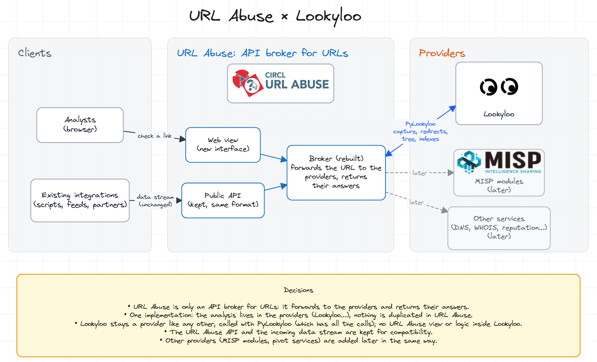

[](https://travis-ci.org/CIRCL/url-abuse)

# URL Abuse


URL Abuse is a versatile free software for URL review, analysis and black-list reporting. URL Abuse is composed of a web interface where requests are submitted asynchronously and a back-end system to process the URLs into features modules.

## Architecture (planned)



URL Abuse is being rebuilt as an **API broker for URLs**: it receives a URL,
forwards it to providers and returns their answers. It does no analysis of its
own.

- **Clients**: analysts use the new web interface; existing integrations keep
  using the public API, whose format and incoming data stream are kept for
  compatibility.
- **Providers**: [Lookyloo](https://github.com/Lookyloo/lookyloo), called
  through [PyLookyloo](https://github.com/Lookyloo/PyLookyloo), is one provider
  among others. MISP modules and other pivot services (DNS, WHOIS, reputation…)
  will be added the same way.
- Nothing specific to URL Abuse is added to Lookyloo.

Interactive version: [project-graph](https://ecrou-exact.github.io/project-graph/?example=urlabuse)
(source: [`doc/architecture/urlabuse-lookyloo.json`](./doc/architecture/urlabuse-lookyloo.json)).
The decisions behind it are listed in [AGENTS.md](./AGENTS.md).

## Features

 - HTTP redirects analysis and follows
 - [Google Safe-Browsing](https://developers.google.com/safe-browsing/) lookup
 - [Phishtank](http://www.phishtank.com/api_info.php) lookup
 - [VirusTotal](https://www.virustotal.com/en/documentation/public-api/) lookup and submission
 - [URL query](https://github.com/CIRCL/urlquery_python_api/) lookup
 - [CIRCL Passive DNS](http://www.circl.lu/services/passive-dns/) lookup
 - [CIRCL Passive SSL](http://www.circl.lu/services/passive-ssl/) lookup
 - [Universal WHOIS](https://github.com/Rafiot/uwhoisd) lookup for abuse contact
 - Sphinx search interface to RT/RTIR ticketing systems. The functionality is disabled by default but can be used to display information about existing report of malicious URLs.

Please note that some of the API services will require an API key. The API keys should be located in the root of the URL Abuse directory.

## Online version

- [CIRCL URL Abuse](https://www.circl.lu/urlabuse/) is online.

If you don't want to use the online version or run your own version of URL Abuse, you can follow the install process below.

## Install

URL Abuse is being rebuilt (see [doc/ROADMAP.md](./doc/ROADMAP.md)). Install
and run: [doc/install.md](./doc/install.md). In short:

```bash
poetry install
echo URLABUSE_HOME="'`pwd`'" > .env
poetry run tools/validate_config_files.py
poetry run tools/3rdparty.py   # front-end libraries (needs Node >= 20)
poetry run start      # http://127.0.0.1:5200, API reference at /api
```

The previous version is tagged `legacy-v1`.

## Contributing

We welcome pull requests for new extensions, bug fixes.

### Add a new module

Look at the existings functions/modules. The changes will have to be made in the following files:

* Add the function you want to execure in url\_abuse\_async.py
* Add a route in web/\_\_init\_\_.py. This route will do an async call to the function defined in url\_abuse\_async.py. The parameter of the function is sent in an POST object
* Add a statement in web/templates/url-report.html. The data option is the parameter to pass to the javascript directive
* Add a directive in web/static/main.js, it will take care of passing the parameter to the backend and regularly pull for the response of the async call

## Partner and Funding

URL Abuse was being developed as part of the [“European Union anti-Phishing Initiative”](http://phishing-initiative.eu/) (EU PI) project. This project was coordinated by Cert-Lexsi and co-funded by the Prevention of and Fight against Crime programme of the European Union.

URL Abuse is currently supported and funded by [CIRCL](https://www.circl.lu/) ( Computer Incident Response Center Luxembourg).
